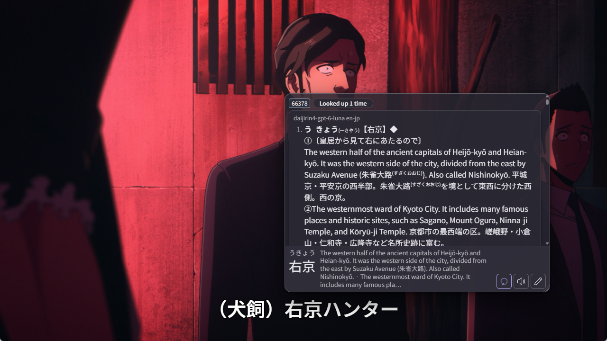

# hachidori-mpv

[Hachidori](https://github.com/bee-san/hachidori) on mpv's subtitles: hover a
word in a subtitle for Hachidori's own popup, with every dictionary, setting
and feature you have in the browser, and mine it to Anki with your own
Templates. The video frame and the subtitle line's audio go on the card too.



## How it works

hachidori-mpv does not reimplement Hachidori. It runs the real Hachidori
extension, in its [overlay mode](https://github.com/bee-san/hachidori/blob/main/docs/overlay-mode.md),
in a transparent window that sits exactly over mpv's video and draws the
current subtitle as text. That Hachidori is **linked through
[Sharing](https://github.com/bee-san/hachidori/blob/main/docs/sharing.md)** to
the Hachidori in your browser, the same way GameSentenceMiner's overlay is:

- lookups use the browser's dictionaries, personal dictionary, lookup counts
  and settings;
- **Anki mining uses the browser's Templates, deck, note type, fields,
  duplicate rules and AnkiConnect address** — the card is the card the
  browser would make;
- mpv adds what a browser cannot see: the Template's `{screenshot}` (and
  `{gif}`) field gets the video frame, and its `{sentence-audio}` field (or
  the blank `SentenceAudio` field of the Kiku, Lapis and Senren note types, as
  Hachidori's Netflix mining fills it) gets the subtitle line's audio, cut
  with ffmpeg. Only empty fields are filled.

```
mpv ── main.lua ── JSON IPC ──► overlay (Electron)
                                 ├─ overlay page: the subtitle as text
                                 └─ Hachidori (overlay mode, linked) ──► Hachidori Relay in Anki ──► your browser's Hachidori
```

The subtitle lines of one cue stay one sentence for Anki, even when the
subtitle wraps over two lines.

## Requirements

- **mpv** 0.35 or newer
- **Hachidori** in your browser with **Settings → Sharing** on, and **Anki**
  with the **Hachidori Relay** add-on (v0.0.5+; Settings → Sharing →
  *Download the Anki add-on*) and AnkiConnect. Both must be running while you
  watch.
- **ffmpeg** for screenshots and sentence audio (the Windows builds of mpv
  usually ship `ffmpeg.exe` next to `mpv.exe`, which is found automatically)
- **Node.js 18+** to install (not to run)
- Linux: an X11 session or XWayland (`mpv --gpu-context=x11egl`), plus
  `xwininfo` and `xprop` (`x11-utils` / `xorg-xwininfo` `xorg-xprop`)

## Install

Clone or download this repository, then:

**Windows** (installs into `%APPDATA%\mpv`):

```powershell
powershell -ExecutionPolicy Bypass -File install.ps1
```

**Linux** (installs into `~/.config/mpv`):

```bash
./install.sh
```

Use `-MpvDir` / `--mpv-dir` for another mpv config folder (for example a
`portable_config`). The installer copies `scripts/hachidori-mpv` and
`script-opts/hachidori-mpv.conf` (an existing conf is kept), downloads
Electron, and downloads the Hachidori release your browser runs (asked from
the relay; `-Release` / `--release` picks another), checks its SHA-256 and
prepares it: overlay mode on, a fixed extension ID, and one hook that reports
added notes. Run it again to update.

## Use

Open a video with Japanese subtitles. The overlay starts by itself, links to
your browser's Hachidori the first time (*Hachidori: linked to …*), and
replaces mpv's subtitles with its own.

- **Hover** a word in the subtitle: Hachidori's popup. The video pauses while
  the pointer is on a subtitle or a popup is open and resumes when it leaves.
- **Mine** with the popup's Anki button, exactly as in the browser. mpv then
  adds the picture and sentence audio and says so on screen.
- The rest of the popup is Hachidori's own: pronunciation audio, nested
  lookups, lookup counts, duplicate detection against your collection, the
  personal dictionary pencil and custom buttons.

While the overlay is on:

| Key | | |
| --- | --- | --- |
| `←` / `→` | `key_prev_sub` / `key_next_sub` | Previous / next subtitle line |
| `r` | `key_repeat` | Repeat the current line over and over; press again to stop. `←`/`→` move the loop to the previous/next line, and a ↻ beside the subtitle shows it is on |

These are set in the plugin's Settings window (or the conf) and give mpv its
own bindings back when the overlay is off. The repeat is mpv's A-B loop over
the line, padded like the sentence audio.

Always:

| Key | Binding | |
| --- | --- | --- |
| `Alt+h` | `hachidori_mpv/toggle` | Overlay on/off (mpv's subtitles come back) |
| `Alt+o` | `hachidori_mpv/plugin-settings` | The plugin's Settings window |
| `Alt+H` | `hachidori_mpv/settings` | Hachidori Settings |
| — | `hachidori_mpv/repeat` | Repeat on/off, for another key in `input.conf` |
| — | `hachidori_mpv/reload` | Reload the overlay page |

Rebind them in `input.conf`, e.g. `Ctrl+d script-binding hachidori_mpv/settings`.

Hachidori's Settings window is the linked Hachidori: changes there change the
shared Hachidori, except the reading-surface preferences overlay mode keeps
per overlay (activation, scan delays, popup size and so on).

## Settings

**Alt+o** opens the plugin's Settings window. Every change is saved at once
to `script-opts/hachidori-mpv.conf` and applies to every open mpv:

- **Picture** — a still frame (format, height, quality) or an **animated
  clip** with [Anki Miner](https://github.com/0xzerolight/anki_miner)'s
  settings: AVIF or WebP (AVIF falls back to WebP when ffmpeg has no
  SVT-AV1), clip length from the subtitle's start, capped by the subtitle
  (*0 = same as sentence audio*), and the Small / Balanced / High / Custom
  size presets (frame rate, height, quality).
- **Sentence audio** — Opus or MP3, bitrate, padding before and after.
- **Card fields** — other fields than the Template's own.
- **Playback & keys** — the navigation and repeat keys, pausing on hover,
  starting with every video, hiding mpv's subtitles.
- **Subtitles** — font, size, weight, colours, outline, position.
- **Advanced** — ffmpeg, AnkiConnect and relay addresses, developer tools.

The conf documents every option for editing by hand. For more styling, put
CSS in `script-opts/hachidori-mpv.css`, for example:

```css
#subtitle { font-family: "Klee One"; letter-spacing: 0.05em; }
```

## Notes

- The overlay replaces mpv's *primary* subtitles; ASS signs and positioning
  are not drawn while it is on. Secondary subtitles stay mpv's.
- The popup takes the mouse but never the keyboard, so mpv's keys keep
  working while it is open.
- One overlay process serves every mpv window. It quits with the last one.
- Overlay data (the linked Hachidori's storage) lives in
  `%APPDATA%\hachidori-mpv` / `~/.config/hachidori-mpv`.
- Tested on Windows 11 with mpv 0.41. The Linux (X11) window tracking is
  written but not yet tested. Wayland without XWayland cannot place a window
  over another; macOS is not supported yet.

## Troubleshooting

The overlay writes what it does to `overlay.log` in its data folder:

- Windows: `%APPDATA%\hachidori-mpv\overlay.log`
- Linux: `~/.config/hachidori-mpv/overlay.log`

Please attach it to a bug report, together with your OS, mpv version and
whether mpv was windowed or fullscreen.

## Development

```bash
cd scripts/hachidori-mpv/overlay
npm install --ignore-scripts && node fetch-electron.mjs
node prepare-hachidori.mjs --source /path/to/hachidori/extension   # or --release 0.3.1
npm test
```

Set `HACHIDORI_MPV_DEBUG_PORT=9333` before starting mpv to reach the overlay
with Chrome DevTools, or `debug=yes` to open DevTools with it.

## License

GPL-3.0-or-later, like Hachidori, which this runs unmodified apart from the
documented overlay-mode flag, extension key and note hook.
